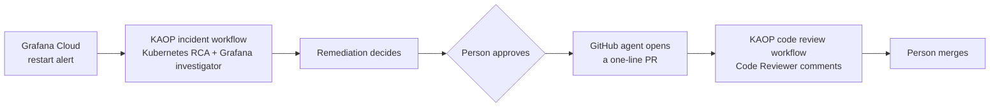

# KAOP incident lab: one bad rollout, two governed workflows

A small Kubernetes lab that shows how the
[Komodor Agentic Operations Platform](https://docs.komodor.com/get-started/overview.md) (KAOP) lets a platform
team run AI agents on production work with control: each agent has its own identity, least-privilege access,
a person's approval before any change, and a recorded run.



## The scenario

| | |
|---|---|
| **Service** | A Python API (`app.py`) backed by Redis. `/healthz` says the process is alive; `/readyz` says Redis answers. |
| **Bad rollout** | The latest commit on `main` points the API's liveness probe at `/readyz`. It reads sensibly and passes CI, because nothing breaks while Redis is up. The defect is deliberate and models a well-intentioned change. |
| **Incident** | Redis goes down. Readiness fails, which is correct. Liveness fails too, so Kubernetes kills a healthy API again and again, and the restart alert pages the API owners for a Redis problem. |
| **Finding** | Trigger: Redis outage. Root cause of the restarts: liveness depends on Redis. Fix: one line, liveness back to `/healthz`. |

Measured on this lab with the same Redis outage:

| | Liveness checks Redis | Liveness checks the process |
|---|---|---|
| Times Kubernetes killed the healthy API | 5 in 5 minutes | 0 |
| Grafana restart alert | Fired after about 3 minutes | Stayed quiet |

Details: [docs/evidence.md](docs/evidence.md).

## Who can do what

| Agent | Can change | Enforced by |
|---|---|---|
| Kubernetes RCA, in the cluster | Nothing. Reads pods, events, logs and workloads; no Secrets, no exec | Kubernetes RBAC on its own ServiceAccount |
| Grafana investigator | Nothing | A Grafana Viewer token |
| Remediation | Nothing | It holds no credentials |
| GitHub agent | One pull request for one config value, after a person approves | KAOP approval gate and GitHub app scopes |
| Code Reviewer | One comment per commit; cannot approve or merge | GitHub app scopes |

The Kubernetes boundary was checked against KAOP's own agent chart with `kubectl auth can-i`
(`scripts/verify-agent-rbac.sh`). Design and reasoning: [docs/architecture.md](docs/architecture.md).

## Repository map

| Path | What it is |
|---|---|
| `app.py`, `k8s/` | The service and its manifests; `k8s/api-configmap.yaml` is generated from `app.py` |
| `scripts/demo.sh` | Operator CLI: `preflight`, `deploy --ref`, `outage`, `evidence`, `reset` |
| `scripts/grafana_lab.py`, `monitoring/` | Grafana alert rule, dashboard and KAOP routing as code ([docs/grafana.md](docs/grafana.md)) |
| `scripts/verify-agent-rbac.sh` | Shows what an agent's Kubernetes identity can and cannot do |
| `docs/kaop-setup.md` | KAOP configuration, step by step |
| `docs/runbook.md` | Demo runbook and fallbacks |
| `docs/presentation/` | Customer deck (PPTX and PDF) |

## Run it

You need a kind cluster named `kaop-demo`, kubectl, git, Python 3.9 or later, and Grafana Cloud Kubernetes
Monitoring installed with cluster name `kaop-demo`.

```bash
./scripts/demo.sh deploy --ref origin/main --approve-live-mutation   # apply k8s/ exactly as it is in git
./scripts/demo.sh preflight                                          # read-only health check
./scripts/demo.sh outage --approve-live-mutation                     # Redis outage; Ctrl-C brings Redis back
```

Commands that change the cluster require `--approve-live-mutation`. The CLI only touches the `kaop-demo`
namespace, never reads Secrets, and refuses any other kubeconfig context.

Checks (CI runs the same):

```bash
python3 -m pip install PyYAML==6.0.2
python3 -B scripts/sync-configmap.py --check
python3 -B -m unittest discover -s tests -v
```
