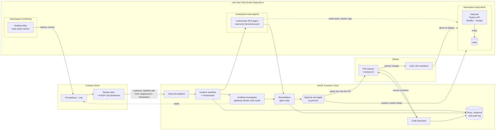
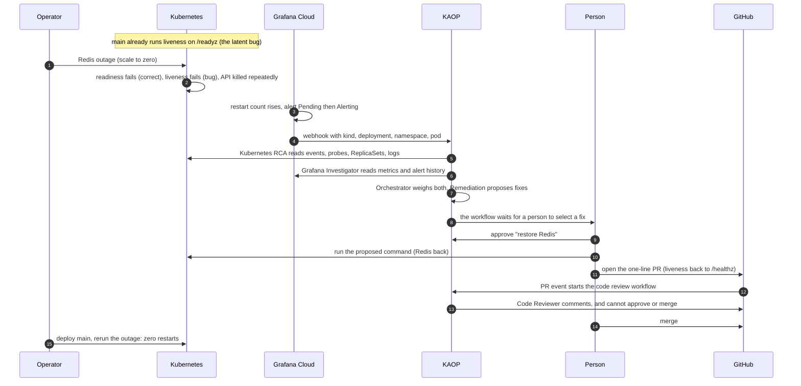

# KAOP incident lab: one bad rollout, two governed workflows

A small, real Kubernetes lab that shows how the
[Komodor Agentic Operations Platform](https://docs.komodor.com/get-started/overview.md) (KAOP) lets a platform
team put AI agents on production work without losing control. Every agent has its own identity, least-privilege
access, a person's approval before any change, and a recorded run. Both workflows below run on a real KAOP
workspace and were rehearsed end to end.

## The idea

Most engineering teams already have AI agents. Support has a bot, SRE wired one to monitoring, developers added
one to pull requests. The hard part is not building agents. It is knowing who owns them, what they can touch,
and what they did.

This lab answers those questions with one realistic incident, handled end to end:

1. A well-intentioned change ships a latent bug.
2. A dependency outage exposes it.
3. Grafana Cloud alerts.
4. KAOP agents investigate in parallel and propose fixes. A person approves and applies one.
5. The durable fix goes out as a pull request, which a separate KAOP agent reviews automatically.

Every step runs under an identity, inside a boundary that something other than a prompt enforces, and leaves a
record.

**Why this incident.** A liveness probe that depends on a downstream service is a common, real misconfiguration.
It passes review and CI, hides while everything is healthy, and only shows up when the dependency blips. The fault
lives in how two components interact, not inside one function, so finding it takes real investigation.

## Architecture



Every connection from the lab host is outbound: Alloy pushes telemetry to Grafana Cloud, and the in-cluster agent
dials the KAOP control plane. Nothing on the host listens on the internet.

## How the incident unfolds



## The scenario

| | |
|---|---|
| **Service** | A Python API (`app.py`) backed by Redis. `/healthz` says the process is alive; `/readyz` says Redis answers. |
| **Bad rollout** | The latest commit on `main` points the API's liveness probe at `/readyz`. The defect is deliberate and models a well-intentioned change. |
| **Incident** | Redis goes down. Readiness fails, which is correct. Liveness fails too, so Kubernetes kills a healthy API again and again, and the restart alert pages the API owners for a Redis problem. |
| **Finding** | Trigger: Redis outage. Root cause of the restarts: liveness depends on Redis. Fix: one line, liveness back to `/healthz`. |

Measured on this lab with the same Redis outage:

| | Liveness checks Redis | Liveness checks the process |
|---|---|---|
| Times Kubernetes killed the healthy API | 5 in 5 minutes | 0 |
| Grafana restart alert | Fired after about 3 minutes | Stayed quiet |

Details: [docs/evidence.md](docs/evidence.md).

## Who can do what

| Agent | Can change | Enforced by |
|---|---|---|
| Kubernetes RCA, in the cluster | Nothing. Reads pods, events, logs and workloads; no Secrets, no exec | Kubernetes RBAC on its own ServiceAccount |
| Grafana Investigator | Nothing. Reads metrics, logs and alerts | KAOP gateway: only read tools pass; writes, the generic Grafana API tool, plugin installs and tool families this stack doesn't use are denied |
| Workflow Orchestrator | Nothing. Routes work between agents | Worker allowlist: it can call only the agents bound to the workflow |
| Remediation | Nothing. Proposes fixes with commands, undo and verification | Plan-only by design |
| Code Reviewer | One comment per commit; cannot approve or merge | GitHub app scopes |

The Kubernetes boundary was checked against KAOP's own agent chart with `kubectl auth can-i`
(`scripts/verify-agent-rbac.sh`): it can read pods, events and logs, and is denied Secrets, exec, delete, patch and scale.
The gateway boundary was checked by asking the Grafana Investigator to create an annotation, and later to call the
generic `grafana_api_request` tool: KAOP refused both before they reached Grafana ("Tool ... is not permitted").

Around the agents: each one carries an owner and team label, the incident workflow has a daily budget that blocks new
investigations at its cap (tested: an alert over the cap was not investigated), and a knowledge-base doc
([docs/platform-standards.md](docs/platform-standards.md)) gives the agents the team's probe policy and service facts.

KAOP also keeps the record honest: when a person applies the approved fix, the workflow stops for review and refuses
to record the change as applied by an agent.

## Against the brief

| The brief asks | Where it is |
|---|---|
| A small app with two parts, where the fault hides in how they interact | `app.py` (API) and Redis; the fault is the API's liveness probe depending on Redis |
| Code on public GitHub | This repository |
| Grafana Cloud free tier fires the alert | Restart alert routed to a KAOP endpoint ([docs/grafana.md](docs/grafana.md)) |
| A code review agent that comments on new PRs on its own, shown on a real PR | Code Reviewer comments on [PR #1](https://github.com/chizeni24/komodor-production-lab/pull/1) and [PR #2](https://github.com/chizeni24/komodor-production-lab/pull/2), the fix for this incident. Both were closed unmerged, so `main` keeps the bug for the next run |
| A KAOP agent on the cluster that sees pods, events and restarts | Kubernetes RCA, self-hosted in namespace `kaop-agents` |
| The alert routed into a workflow that runs without hand-holding | KAOP incident workflow: alert, investigation and proposed fixes run on their own; a person selects the fix |
| What the agent can see and touch, and what enforces it | [Who can do what](#who-can-do-what): Kubernetes RBAC, KAOP's gateway, plan-only Remediation |
| A real finding: root cause, confidence, suggested fix | Each incident's investigation and remediation output ([docs/evidence.md](docs/evidence.md)) |
| A real incident, reproduced for real | `scripts/demo.sh outage`: real pod events, logs and restart counts |
| **Optional:** more than one agent, with handoffs | Done. The orchestrator runs the Kubernetes RCA and the Grafana Investigator in parallel, weighs their evidence, and hands the result to Remediation, which proposes fixes for a person to select |
| **Optional:** a deeper Grafana Cloud integration | Done. The Grafana Investigator queries Prometheus, Loki and alert history through KAOP's gateway |

## Design decisions

- **Catalog agents, not custom ones.** The Kubernetes RCA agent is built from Klaudia's root-cause knowledge, and its boundary is a Kubernetes ServiceAccount rather than a prompt.
- **A pull request, not a live patch.** Git is the source of truth. A live fix would drift from git and skip review. `scripts/demo.sh deploy` applies `k8s/` from a git ref, standing in for Argo CD or Flux.
- **Fix the probe, keep the probe.** Liveness moves to `/healthz` rather than being removed, so a genuinely stuck process is still restarted.
- **Probe timeouts above the dependency timeout.** Probes allow 3 s, the Redis client 2 s, so a slow host or dependency doesn't cause false liveness failures.
- **The alert describes the symptom, not the answer.** It carries the workload's identity and restart count, and nothing that hints at the cause.

More: [docs/architecture.md](docs/architecture.md).

## Repository map

| Path | What it is |
|---|---|
| `app.py`, `k8s/` | The service and its manifests; `k8s/api-configmap.yaml` is generated from `app.py` |
| `scripts/demo.sh` | Operator CLI: `preflight`, `deploy --ref`, `outage`, `evidence`, `reset` |
| `scripts/grafana_lab.py`, `monitoring/` | Grafana alert rule, dashboard and KAOP routing as code ([docs/grafana.md](docs/grafana.md)) |
| `scripts/verify-agent-rbac.sh` | Shows what an agent's Kubernetes identity can and cannot do |
| `scripts/lab-shortcuts.sh` | Short shell commands for the live demo (`lab-check`, `lab-break`, `lab-fix`, `lab-pr`) |
| `docs/architecture.md` | Workflows, boundaries and design choices in detail |
| `docs/evidence.md` | Measured runs: probe comparison and both KAOP rehearsals |
| `docs/kaop-setup.md` | KAOP configuration, step by step |
| `docs/platform-standards.md` | The knowledge-base doc the agents read: probe policy and service facts |
| `docs/runbook.md` | Demo runbook and fallbacks |
| `docs/presentation/` | Customer deck (PPTX and PDF) |

| Branch | Purpose |
|---|---|
| `main` | The lab, ending in the bad-rollout commit the incident exposes |
| `fix/decouple-liveness` | The one-line fix a person opens as a pull request during the demo |
| `feature/memory-leak-scenario` | An optional second fault: a gradual memory leak ending in `OOMKilled` |

## Run it

You need a kind cluster named `kaop-demo`, kubectl, git, Python 3.9 or later, and Grafana Cloud Kubernetes
Monitoring installed with cluster name `kaop-demo`.

```bash
./scripts/demo.sh deploy --ref origin/main --approve-live-mutation   # apply k8s/ exactly as it is in git
./scripts/demo.sh preflight                                          # read-only health check
./scripts/demo.sh outage --approve-live-mutation --max-seconds 1800  # Redis outage until someone restores it
kubectl scale deployment/redis -n kaop-demo --replicas=1             # the fix KAOP proposes; the outage then ends
```

Commands that change the cluster require `--approve-live-mutation`. The CLI only touches the `kaop-demo`
namespace, never reads Secrets, and refuses any other kubeconfig context.

Checks (CI runs the same):

```bash
python3 -m pip install PyYAML==6.0.2
python3 -B scripts/sync-configmap.py --check
python3 -B -m unittest discover -s tests -v
```
