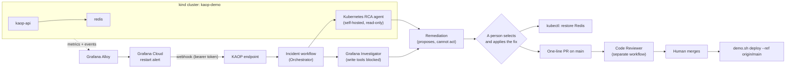

# Architecture

## The incident

A two-tier service: a Python API that serves requests from Redis. The API exposes two health endpoints.

| Endpoint | Answers | Depends on Redis |
|---|---|---|
| `/healthz` | Is this process alive? | No |
| `/readyz` | Can this pod serve traffic right now? | Yes, it sends `PING` |

**The bad rollout.** A well-intentioned change on `main` points the API's *liveness* probe at `/readyz`, so
"restart the pod if it can't reach Redis." It reads sensibly in review and it passes every test, because nothing
is wrong while Redis is healthy. This is the latent defect the incident exposes.

**The trigger.** Redis becomes unavailable. In the lab, `scripts/demo.sh outage` scales Redis to zero, which stands
in for a node loss, an eviction or a maintenance window.

**What happens.**

1. Readiness fails, which is correct: Kubernetes stops sending traffic to the pod.
2. Liveness also fails, which is the defect. The kubelet kills a perfectly healthy API process, five times in a five-minute rehearsal, dropping in-flight work each time.
3. Grafana's restart alert fires and pages the API owners, pointing responders at the wrong service.
4. Kubernetes adds back-off between restarts: 10 s, doubling up to 5 minutes. If Redis returns during a back-off, the API waits it out before serving again.

**The correct conclusion.**

| | |
|---|---|
| Trigger | Redis became unavailable |
| Root cause of the restarts | Liveness is coupled to a downstream dependency |
| Immediate mitigation | Restore Redis |
| Durable fix | Liveness → `/healthz`; keep `/readyz` for readiness (one line in `k8s/api.yaml`) |
| Prevention | A probe standard (`scripts/check-probes.py`); in KAOP terms, a Production Readiness standard |

Measured results for both probe configurations are in [evidence.md](evidence.md).

## The two KAOP workflows

**Workflow 1: incident.** KAOP's Incidents module runs the workflow *KAOP lab: Production Alert Investigation* on the
human-selected template: Investigate → Propose remediation → Select remediation (a person) → Apply → Verify →
Postmortem. The Workflow Orchestrator runs the steps and may call only the agents bound to the workflow.

- **Source.** Grafana Cloud posts the restart alert to a KAOP inbound endpoint (Integrations → Endpoints) with a bearer token. The workflow accepts only alerts labelled `kaop=incident`, and each firing (its `startsAt`) becomes its own incident.
- **Investigation.** Two catalog specialists run in parallel.
  - **Kubernetes RCA** runs inside the lab cluster. It takes a named resource, `Deployment/kaop-api` in `kaop-demo`, reconstructs what changed around it, and reads its dependencies.
  - **Grafana Investigator** runs in Komodor cloud and reads the metrics, events and alert history.
- **Remediation.** The *Remediation* agent reads the finished investigation and proposes options, each with the command, an undo plan and a verification check. The workflow then waits for a person to select one. This workspace has no agent that can apply a fix, so the person applies it (the Redis restore with `kubectl`, the probe fix as a pull request). KAOP then stops the run for review and refuses to record the change as applied by an agent. KAOP's Remediation Executor would take this step under its own identity, after the same approval.

**Workflow 2: code review.** The repository is bound to the review workflow through KAOP's GitHub App. Every push
to a pull request starts a *Code Reviewer* run, which posts one comment with a verdict: Changes requested,
Comments, or Looks good. It never casts a GitHub approval and never merges.

**Closing the loop.** A person merges. `scripts/demo.sh deploy --ref origin/main` applies `k8s/` from git, standing
in for Argo CD or Flux. Running the same outage again verifies the fix: zero restarts, and recovery as soon as Redis returns.

## Boundaries: who can do what, and what enforces it

| Agent | Runs in | Can read | Can change | Enforced by |
|---|---|---|---|---|
| Kubernetes RCA | Lab cluster, own namespace | Kubernetes `view` role plus cluster-scoped reads (nodes, PVs, storage, CRDs, metrics) | Nothing. Secrets, `pods/exec` and all writes are absent | Kubernetes RBAC on its own ServiceAccount, checked with `scripts/verify-agent-rbac.sh` |
| Grafana Investigator | Komodor cloud | Prometheus, Loki, alert state | Nothing, except short links to its evidence | KAOP gateway group `grafana-cloud-tools`: an allow list of 28 read tools, with a deny list for writes on top; tools outside it return "Tool not found" |
| Workflow Orchestrator | Komodor cloud | Findings from the specialists | Nothing | Worker allowlist: only the agents bound to the workflow |
| Remediation | Komodor cloud | The investigation it is handed | Nothing | Plan-only by design; it holds no credentials for any target system |
| Code Reviewer | Komodor cloud | The PR diff | One review comment per commit | GitHub App scopes; it cannot approve, so branch protection still needs a human |
| Platform team (you) | The lab host | Everything | Deploys and lab outages | Lab kubeconfig; `--approve-live-mutation` on every write command |

Account-level controls apply across all of them:

- **Identity and ownership.** Each agent has its own identity and revocable worker token, and an `owner`/`team` label. KAOP roles can scope access by these labels.
- **Permissions.** Access is default-deny, and you can audit it in Access explorer.
- **Approvals.** Decisions wait on the incident page (the KAOP bell links to them) and are recorded on the run.
- **Audit log.** It is append-only.
- **Budgets.** The incident workflow has a $40 daily cap that blocks new investigations. Tested by setting it to $0.01: the next alert was recorded but not investigated.
- **Evidence.** Every run records its inputs, tool calls, reasoning, output and cost.
- **Standards in the knowledge base.** [platform-standards.md](platform-standards.md) gives the agents the probe policy and what each endpoint checks.

**Pre-verified before access.** KAOP's self-hosted agent chart (`agentops-agent-base` 0.1.2320) was rendered with
`rbac.create=true`, and only its RBAC objects were applied to a throwaway namespace. The checker confirmed
read-only access with no Secrets, exec or writes. Everything was then deleted. Re-run the same script against the
real agent's ServiceAccount after installation.

## What the alert carries

The KAOP endpoint receives Grafana's standard webhook payload. The rule (`monitoring/alert-rule.json`) adds the
identity the Kubernetes RCA input needs, and deliberately describes only the symptom:

| Label | Value |
|---|---|
| `kind` / `deployment` / `namespace` / `cluster` | `Deployment` / `kaop-api` / `kaop-demo` / `kaop-demo` |
| `pod`, `container` | From `sum by (cluster, namespace, pod, container)` |
| `kaop` | `incident`, the routing key for the KAOP contact point |
| `severity`, `service`, `team` | `critical`, `kaop-api`, `sre` |

## Design choices worth defending

- **Catalog Kubernetes RCA over a custom agent.** It is built from Klaudia's root-cause knowledge. Its boundary is a Kubernetes ServiceAccount rather than a prompt. Building our own would add risk and no customer value.
- **A pull request over a live patch.** Git is the source of truth. A live patch would create drift and skip review. KAOP's Remediation Executor can act on live resources through Klaudia, but that is the wrong default for a configuration defect.
- **Liveness on `/healthz` rather than no liveness probe.** A wedged process should still be restarted. It just must not be restarted for a dependency's failure.
- **Explicit probe timeouts (3 s) above the Redis client timeout (2 s).** This keeps host stalls and slow dependencies from becoming false liveness failures.

## Known limits of the lab

- Single-node kind cluster. The Redis outage is simulated by scaling to zero.
- The cluster is not GitOps-managed. `demo.sh deploy` applies a git ref on request.
- Kubernetes events are shipped to Loki, but API stdout is not. Logs are read through the Kubernetes API.
