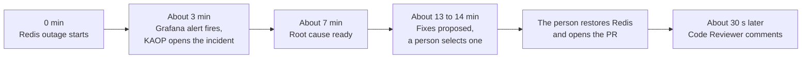

# Demo runbook

Everything runs on one machine: the kind cluster, the terminal and the browser you present from. The host has
22 GB of RAM. Before an upgrade from 7 GB, a browser memory spike stalled the node once (probes now allow 3 s, which
absorbs short stalls).

- Use one browser with only the demo tabs open, and close other apps.
- Check free memory before you start: `free -m` should show at least 2 GB available.

```bash
cd ~/komodor-demo
source scripts/lab-shortcuts.sh    # lab-check, lab-break, lab-fix, lab-pr, lab-proof, lab-reset
```

## T-60 minutes

```bash
git pull --ff-only
./scripts/demo.sh preflight                   # expect: LATENT DEFECT: liveness ... /readyz
python3 scripts/grafana_lab.py status         # expect: Normal, workload labels yes, KAOP route configured
```

- If preflight says the probes are decoupled, a previous fix was deployed. Put the bad rollout back with `./scripts/demo.sh deploy --ref origin/main --approve-live-mutation`, assuming `main` still carries it.
- Make sure no rehearsal PR is still open.
- Open these tabs, and nothing else:
  1. The deck.
  2. KAOP: Incidents, Standards & Guardrails (Activity tab), and the Audit log.
  3. The Grafana *KAOP Lab* dashboard (`/d/kaop-lab`), which shows restarts, Redis, the alert and events on one screen.
  4. GitHub, on branch `fix/decouple-liveness`.
  5. The rehearsal incident in KAOP, as a fallback.

## Live

Start the outage when the talk begins. The decision is ready about 13–14 minutes later, when the demo starts.

| Step | Do | What it shows |
|---|---|---|
| 0 | Start the outage: `lab-break` (runs `./scripts/demo.sh outage --approve-live-mutation --max-seconds 1800`) | Redis goes to zero; the script prints restarts as they happen |
| 1 | Terminal: `restarts=+N`, `CrashLoopBackOff` | Readiness fails (correct); liveness fails too (the bug) |
| 2 | *KAOP Lab* dashboard: Redis at 0, restarts climbing, alert Alerting about 3 minutes in | Grafana detects and routes the alert to KAOP |
| 3 | KAOP incident: two investigators, root cause, confidence, evidence, tool calls | Trigger and root cause, separated, with evidence |
| 4 | KAOP bell → incident → select "Scale redis back to 1 replica" | The agent proposes; a person decides, and the decision is recorded |
| 5 | `lab-fix`, which runs `kubectl scale deployment/redis -n kaop-demo --replicas=1` (the outage script then ends itself) | The person runs the exact command KAOP proposed |
| 6 | Incident timeline: "Workflow stopped for review" | KAOP won't record a change no agent made |
| 7 | `lab-pr`, or GitHub: `fix/decouple-liveness` → Compare & pull request → Create; the Code Reviewer comments in about 30 s | A separate workflow and identity that can comment but never merge |
| 8 | Terminal RESULT line or dashboard: API back | The bad check delays recovery by the restart back-off; the fix removes it |

**Timing.** Rehearsed on 2026-10-25: alert at +3 min, root cause at +7, decision ready at +13.6, Code Reviewer
comment 33 s after the PR. Live on 2026-10-28: incident 12 s after the alert, root cause about 7 minutes later,
options ready about 12 minutes after the alert, Code Reviewer verdict 29 s after the PR. With the bad check, the API took 218 s to recover after Redis returned (restart back-off).



## Fallbacks

- **Alert still Firing from a rehearsal.** `outage` refuses to start. Wait for Normal. If you must go on, use `--skip-grafana-check`, but KAOP will not get a fresh notification.
- **KAOP slow.** Open the completed incident from the rehearsal in KAOP's incident list and walk through it. Say it is the rehearsal run.
- **Decision not ready yet.** Walk through the investigation runs and their tool calls first.
- **PR not reviewed.** Check the repository is still bound in KAOP's code review workflow; push an empty commit to re-trigger.
- **Something stuck.** Run `./scripts/demo.sh reset --approve-live-mutation`. It restores Redis and waits for the API. It never edits the API spec.
- **Cluster unresponsive.** Present the rehearsal results from the deck's appendix and [evidence.md](evidence.md). Do not rebuild live.

## Evidence

`./scripts/demo.sh evidence` writes a sanitized snapshot to `artifacts/incidents/`. Every `outage` run also keeps
its baseline, first restart, before-restore evidence and result there.

## If the lab must move to a cloud VM

Only needed if this machine can't be used on the day. It takes about an hour, so do it at
least a day before.

1. Create an Ubuntu VM with 4 vCPU and 16 GB. Install Docker or Podman, kind, kubectl, helm and git.
2. Run `kind create cluster --name kaop-demo`. The scripts expect context `kind-kaop-demo` and node `kaop-demo-control-plane`.
3. In Grafana Cloud, go to Kubernetes Monitoring, then Configuration. Install it with cluster name **`kaop-demo`**, so the existing alert query still matches.
4. Clone the repo, copy `~/.config/komodor-secrets/`, then run `./scripts/demo.sh deploy --ref origin/main --approve-live-mutation`.
5. Install the KAOP Kubernetes RCA agent there, as in [kaop-setup.md](kaop-setup.md) step 2.
